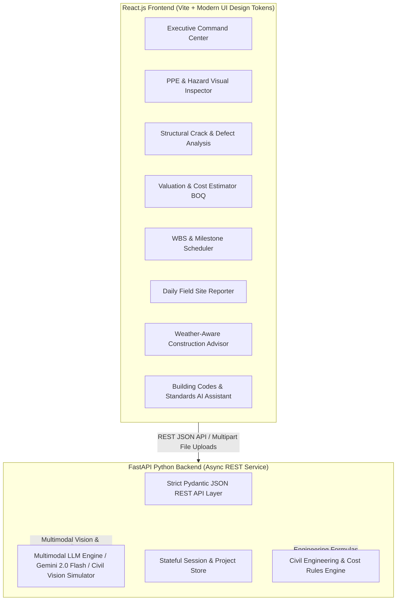

# AI-Powered Multimodal Construction Intelligence Platform

[](https://fastapi.tiangolo.com)
[](https://react.dev)
[](https://ai.google.dev)
[](tests)

An intelligent, full-stack decision-support system designed to assist construction managers, structural engineers, safety inspectors, and cost estimators across all phases of construction planning, execution, and monitoring.

The platform leverages **multimodal artificial intelligence** (visual inspection + textual reasoning + parametric civil engineering modeling) with strict JSON data contracts between a modern **React.js** frontend and a **FastAPI** Python backend.

---

## Technical Architecture



---

## 9 Epics & 18 Tasks Implementation Matrix

| Epic | Subtasks & Modules | Description |
| :--- | :--- | :--- |
| **Epic 1: Full-Stack Architecture & Foundation** | **Task 1.1**: FastAPI Backend Architecture<br>**Task 1.2**: React.js Responsive UI System | Asynchronous FastAPI service with CORS, strict Pydantic schemas, and modern cyber-industrial React design system. |
| **Epic 2: Multimodal Site Safety Monitoring** | **Task 2.1**: Computer Vision PPE & Hazard API<br>**Task 2.2**: Visual Safety Inspection UI | Analyzes site photos for hardhats, high-vis vests, steel-toe boots, fall harnesses, open edge risks, and OSHA 1926 citations. |
| **Epic 3: Structural Crack & Defect Assessment** | **Task 3.1**: Crack Classification & Sizing API<br>**Task 3.2**: Forensic Defect Diagnosis UI | Multimodal inspection of concrete beams, columns, and slabs with width/length estimation and ACI 224R remediation plans. |
| **Epic 4: Construction Cost Estimation & Valuation** | **Task 4.1**: BOQ & Parametric Cost Engine<br>**Task 4.2**: Real Estate Valuation UI | Generates dynamic Bill of Quantities (cement, steel, finishing, labor), regional multipliers, and completed market ROI. |
| **Epic 5: Project Planning & Scheduling Assistant** | **Task 5.1**: WBS & Critical Path Generator<br>**Task 5.2**: Phased Milestone Scheduler UI | 6-phase Work Breakdown Structure (Excavation to Handover) with critical path identification and procurement lead times. |
| **Epic 6: Daily Site Log & Field Assistant** | **Task 6.1**: Field Notes & Blocker Synthesizer<br>**Task 6.2**: Daily Site Reporter UI | Extracts unstructured supervisor notes into structured shift reports, productivity indexes, and blocker resolution paths. |
| **Epic 7: Weather-Aware Advisory** | **Task 7.1**: Meteorological Risk Engine<br>**Task 7.2**: 5-Day Workability Dashboard | Analyzes environmental conditions for concrete curing (ACI 305 evaporation index), crane wind limits, and 5-day forecasts. |
| **Epic 8: Construction Knowledge Assistant** | **Task 8.1**: Regulatory Standards Engine<br>**Task 8.2**: Knowledge Chat & Checklist UI | Interactive regulatory assistant grounded in OSHA 1926, International Building Code (IBC 2024), and ACI 318 standards. |
| **Epic 9: Executive Dashboard & Audit Reporting** | **Task 9.1**: Aggregated Project Analytics API<br>**Task 9.2**: Unified Command Center UI | Cross-module executive telemetry, site health score (82%), live defect tallies, and one-click JSON audit report exports. |

---

## Quick Start & Running Locally

### 1. One-Click Launcher (Windows)
Double-click `start_platform.bat` in the root folder. It automatically starts both:
- **FastAPI Backend**: `http://localhost:8000` (Swagger Docs: `http://localhost:8000/docs`)
- **React Frontend**: `http://localhost:5173`

### 2. Manual Execution

#### Backend (FastAPI):
```bash
cd backend
# Run standalone backend runner
python run_backend.py
```

#### Frontend (React + Vite):
```bash
cd frontend
npm run dev
```

---

## Dual-Mode Multimodal AI Engine

1. **Embedded Civil Engineering Simulator (Zero Config / Offline Ready)**:
   - Works immediately out of the box with zero third-party credentials.
   - Accurately classifies defect types, calculates concrete curing parameters, detects simulated PPE hazards, and references OSHA/IBC standards.
2. **Live Google Gemini 2.0 Flash Multimodal Vision**:
   - Provide your `GEMINI_API_KEY` either in `backend/.env` or directly inside the frontend by clicking the **"AI Config"** button in the top navigation bar.
   - Keys are stored securely in your browser's local storage and transmitted via custom header `X-Gemini-API-Key`.

---

## Running Automated Backend Tests

The backend includes a comprehensive `pytest` test suite verifying all 8 API modules and root health contracts:

```bash
cd backend
python -m pytest tests/test_api.py -v
```

**Results:**
```
tests/test_api.py::test_root_and_health PASSED             [ 10%]
tests/test_api.py::test_dashboard_overview PASSED          [ 20%]
tests/test_api.py::test_safety_inspection_json PASSED      [ 30%]
tests/test_api.py::test_safety_upload_inspect PASSED       [ 40%]
tests/test_api.py::test_crack_analysis PASSED              [ 50%]
tests/test_api.py::test_valuation_estimate PASSED          [ 60%]
tests/test_api.py::test_planning_generate PASSED           [ 70%]
tests/test_api.py::test_daily_log_submit PASSED            [ 80%]
tests/test_api.py::test_weather_advisory PASSED            [ 90%]
tests/test_api.py::test_knowledge_query PASSED             [100%]
======================== 10 passed in 1.26s =========================
```

---

## Project Structure

```
SkillWallet-Project/
├── backend/
│   ├── app/
│   │   ├── config.py             # Settings, environment, Gemini config
│   │   ├── main.py               # FastAPI entry point, CORS, routers
│   │   ├── schemas/              # Strict Pydantic JSON contracts (safety, crack, valuation, planning, daily_log, weather, knowledge, dashboard)
│   │   ├── services/             # Multimodal AI, engineering calculation, and simulation engines
│   │   └── routers/              # Clean REST endpoints for all 9 modules
│   ├── tests/
│   │   └── test_api.py           # 10 comprehensive automated unit & contract tests
│   ├── requirements.txt
│   ├── run_backend.py            # Standalone launcher
│   └── .env.example
├── frontend/
│   ├── index.html
│   ├── package.json
│   ├── vite.config.js
│   ├── src/
│   │   ├── api/client.js         # API gateway with dynamic key injection
│   │   ├── components/           # Navbar, Sidebar, ImageUploader, MetricCard, SettingsModal
│   │   ├── views/                # Views for all 8 core platform modules
│   │   ├── App.jsx               # Main state router
│   │   ├── index.css             # Cyber-industrial theme & design tokens
│   │   └── main.jsx
├── render.yaml                   # Render Blueprint for 1-click backend deployment
├── vercel.json                   # Root Vercel SPA routing configuration
├── start_platform.bat            # 1-click launcher for both services
├── start_backend.bat             # Standalone backend launcher
├── start_frontend.bat            # Standalone frontend launcher
└── README.md                     # Complete project documentation
```

---

## Cloud Deployment (Vercel & Render)

### 1. Backend Deployment on Render (FastAPI)
The backend is pre-configured with a Render Blueprint [`render.yaml`](./render.yaml).

**Option A: 1-Click Blueprint (Recommended)**
1. Log into your [Render Dashboard](https://dashboard.render.com/).
2. Click **New +** -> **Blueprint**.
3. Connect your repository: `https://github.com/12solankijay-dot/construction-intelligence-platform`.
4. Render will automatically read `render.yaml`, configure the Python runtime, and deploy the service.
5. Your live backend URL will be: `https://construction-intelligence-backend.onrender.com` (or your custom service name).
6. Verify health status at: `https://<your-render-url>/api/v1/health`.

**Option B: Manual Web Service Setup**
- **Runtime**: Python 3
- **Root Directory**: `backend`
- **Build Command**: `pip install -r requirements.txt`
- **Start Command**: `uvicorn app.main:app --host 0.0.0.0 --port $PORT`
- **Environment Variables**:
  - `PYTHON_VERSION`: `3.11.9`
  - `CORS_ORIGINS`: `*`
  - `GEMINI_API_KEY`: *(Optional - leave blank to use the offline Civil Engineering Simulator)*

---

### 2. Frontend Deployment on Vercel (React + Vite)
The frontend is pre-configured with [`vercel.json`](./vercel.json) for Vite single-page application routing.

**Deploy via Vercel Dashboard:**
1. Log into your [Vercel Dashboard](https://vercel.com/new).
2. Click **Import** next to your GitHub repository `12solankijay-dot/construction-intelligence-platform`.
3. Configure Project:
   - **Framework Preset**: Vite
   - **Root Directory**: `frontend`
   - **Build Command**: `npm run build`
   - **Output Directory**: `dist`
4. **Environment Variables**:
   - `VITE_API_BASE_URL`: `https://<your-render-url>` (e.g. `https://construction-intelligence-backend.onrender.com`)
5. Click **Deploy**. Your live app will be accessible at: `https://<project-name>.vercel.app`.

*Note: You can also adjust or test your backend endpoint at any time in real time by clicking the Settings gear icon in the frontend navbar!*

